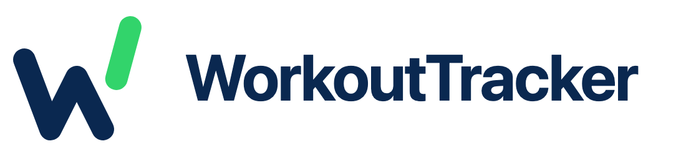
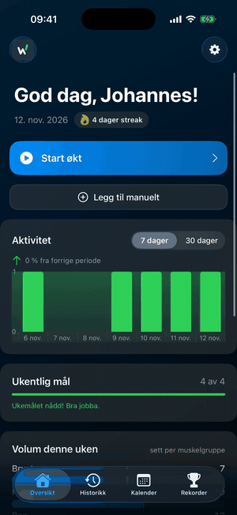
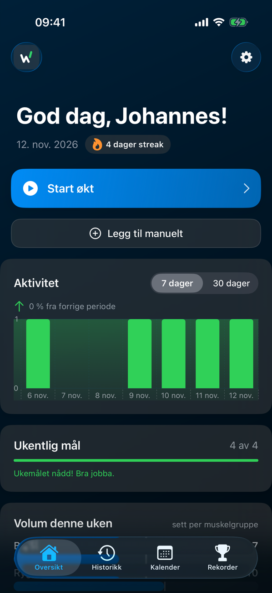
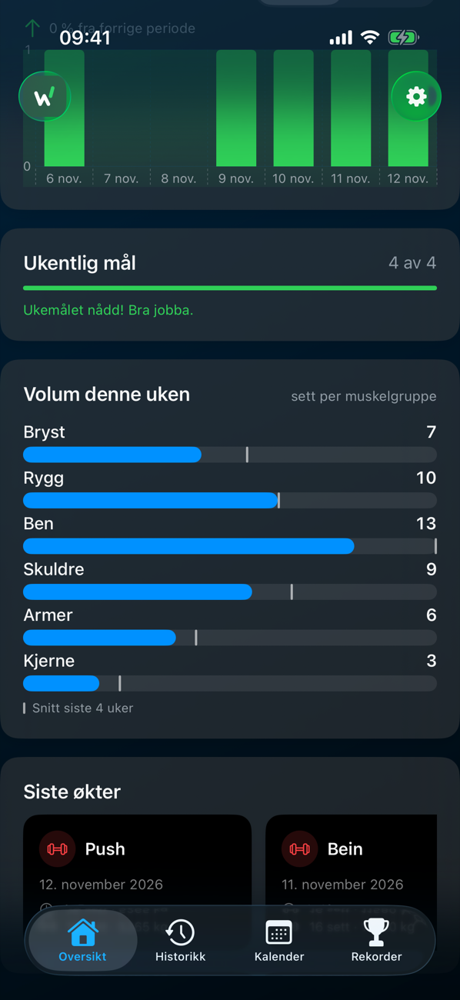
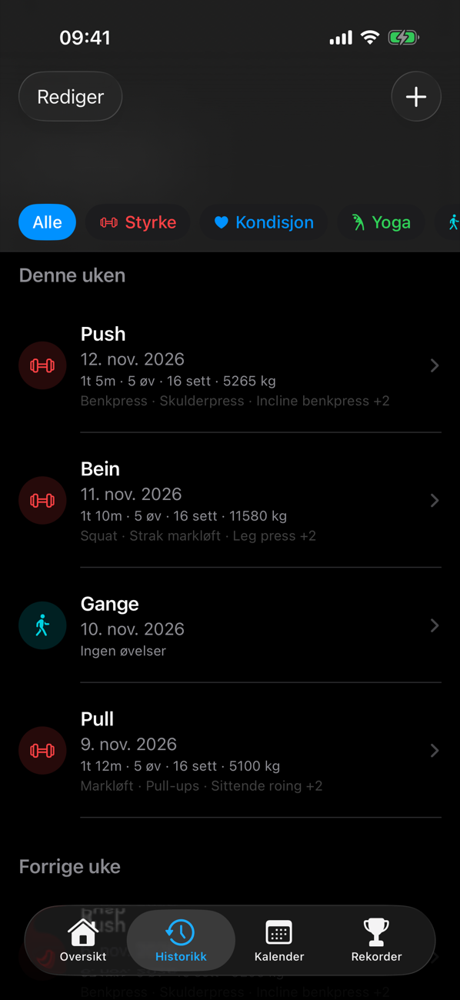
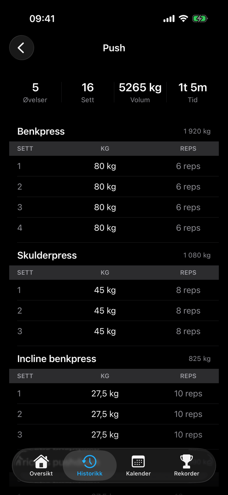
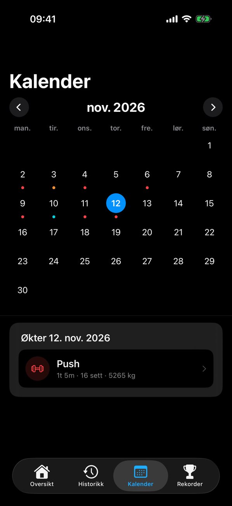
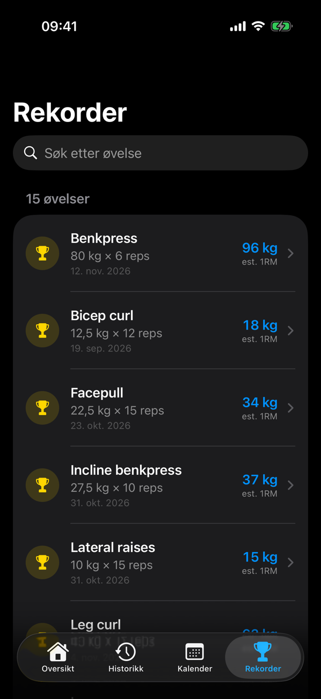
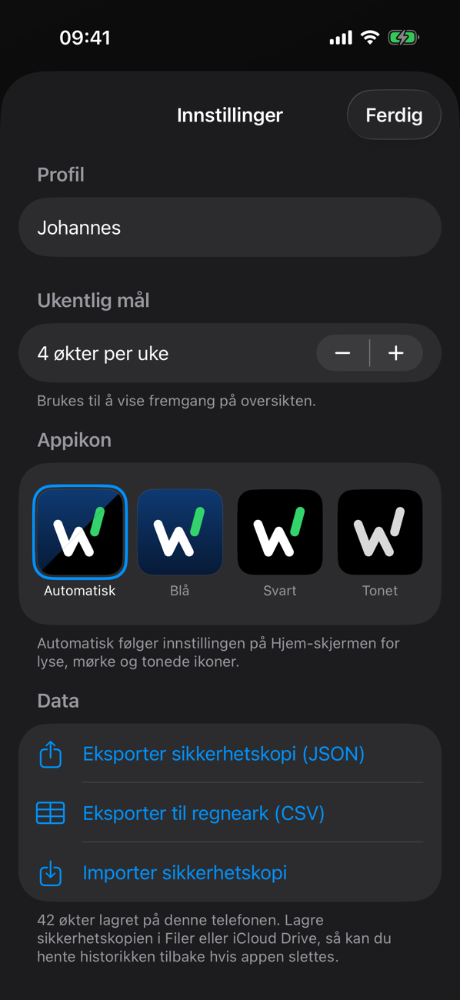

<p align="center">
  <picture>
    <source media="(prefers-color-scheme: dark)" srcset="Branding/workouttracker-logo/wt-horizontal-dark.png">
    
  </picture>
</p>

<p align="center">
  En iOS-app for å logge treningsøkter, følge fremgangen uke for uke og hente økter fra Helse-appen.<br>
  Bygget i SwiftUI, med systemkomponenter og fokus på at det skal gå raskt å logge.
</p>

<p align="center">
  
</p>

---

## Funksjoner

### Oversikt
- Hilsen, dato og **streak** (dager på rad med trening)
- **Start økt** eller legg til en økt manuelt
- Aktivitetsgraf for 7 eller 30 dager, med endring fra forrige periode
- **Ukentlig mål** med fremdriftslinje
- **Volum denne uken:** fullførte sett per muskelgruppe, sammenlignet med snittet de fire forrige ukene
- Siste økter

### Live-økt
- Velg type og kategori, legg til øvelser underveis
- Hak av sett etter hvert. Sett som ikke er haket av, lagres ikke
- **Hviletimer** som starter etter hvert sett, med «Hopp over»
- Notater under økten
- **Live Activity** på låseskjermen og i Dynamic Island
- Banner for pågående økt på tvers av faner. Økten gjenopprettes hvis appen lukkes midt i

### Historikk og kalender
- Økter gruppert per uke, filtrert på kategori (styrke, kondisjon, yoga …)
- Detaljvisning med øvelser, sett, totalt volum og varighet
- Månedskalender med markerte treningsdager og øktene for valgt dag

### Rekorder
- Personlige rekorder per øvelse, rangert etter **estimert 1RM** (Epley), med søk
- Øvelser med bare kroppsvekt rangeres etter antall reps
- Historikk per øvelse med graf over utviklingen

### Helse-appen
- Onboarding for tillatelser
- Importerer `HKWorkout` med `HKAnchoredObjectQuery`: bare nye økter hentes, også økter som synkroniseres sent
- Varighet og kategori mappes til appens egen `Workout`-modell

### Data og innstillinger
- **Eksport** av sikkerhetskopi (JSON) eller regneark (CSV) via delingsarket
- **Import** av sikkerhetskopi med forhåndsvisning: legg til nye økter eller erstatt alle
- Navn, ukentlig mål og **valg av appikon** (automatisk, blå, svart eller tonet)
- Mørk og lys modus

---

## Skjermbilder

<p align="center">
  
  
  
  
</p>
<p align="center">
  
  
  
</p>

Skjermbildene og GIF-en lages automatisk med demodata, se [README-media](#readme-media).

---

## Teknologi og arkitektur

| | |
|---|---|
| Språk og UI | Swift, SwiftUI, Swift Charts |
| Helse | HealthKit (`HKHealthStore`, `HKAnchoredObjectQuery`) |
| Live Activity | ActivityKit og WidgetKit (`WorkoutWidgetExtension`) |
| Lagring | `FilePersistence`: JSON i Application Support, migrerer automatisk fra den eldre `UserDefaults`-lagringen |
| Tester | Swift Testing (enhetstester), XCTest (UI-tester) |

**Struktur**
- `App/`: inngangspunkt, faner og navigasjonskoordinatorer (`HomeNavigationCoordinator`)
- `Core/Domain/`: `Workout`, `Exercise`, `WorkingSet`, øvelseskatalog med muskelgrupper, `WorkoutStore` (`ObservableObject` med debouncet lagring)
- `Core/Services/`: `PRService` (rekorder og e1RM), `ProgressionService` (utvikling per øvelse), `MuscleVolumeService` (ukevolum)
- `Core/Data/`: lagring (`PersistenceService`), HealthKit-import (`WorkoutImportService`, `HealthDataImporter`) og sikkerhetskopi (`WorkoutBackupService`)
- `Features/`: én mappe per skjerm (Home, LiveWorkout, WorkoutList, Calendar, PRs, AddWorkout, UserSettings, HealthKitOnboarding)
- `LiveSessionCoordinator` holder tilstanden til banneret for pågående økt

---

## Kom i gang

**Krav:** Xcode 26.2 eller nyere, iOS 18.2 eller nyere (Live Activity-utvidelsen krever iOS 26.2).

1. Åpne `WorkoutTracker.xcodeproj` i Xcode
2. Velg en simulator eller koble til en iPhone
3. Bygg og kjør (`⌘R`)
4. Gi tilgang til Helse-appen ved første oppstart hvis du vil importere økter

## Testing

```bash
xcodebuild test -project WorkoutTracker.xcodeproj -scheme WorkoutTracker \
  -destination 'platform=iOS Simulator,name=iPhone 17 Pro' -only-testing:WorkoutTrackerTests
```

Enhetstestene dekker blant annet lagring og flyt for økter, idempotent import fra Helse, rekorder og progresjon,
sikkerhetskopi (eksport og import), kalendergrid og logoens geometri og valg av appikon.

## README-media

```bash
scripts/readme-media.sh
```

Skriptet lager en egen simulator, legger inn demodata (`scripts/demo-workouts.py`: åtte uker med Push/Pull/Bein
og noen gåturer og sykkelturer), kjører UI-testen `ReadmeScreenshots` og tar opp skjermen. Skjermbildene og
`tour.gif` havner i `WorkoutTracker/GithubAssets/`. Krever `ffmpeg` (`brew install ffmpeg`).

## Logo

**Climbing W:** en W der det siste strøket er skilt fra og klatrer høyere, som et bilde på neste rep og neste økt.
Logo, app-ikoner, farger og bruksregler ligger i [`Branding/workouttracker-logo`](Branding/workouttracker-logo/README.md).

---

## Videre utvikling

- Flere grafer: volum per uke og fordeling per kategori
- Innstillinger for kg/lbs og standardvalg for nye økter
- iCloud-synkronisering, eventuelt via SwiftData
- Bedre VoiceOver-beskrivelser av grafene

---

<p align="center">
  Laget av <strong>Johannes Støen</strong> © 2025–2026
</p>
